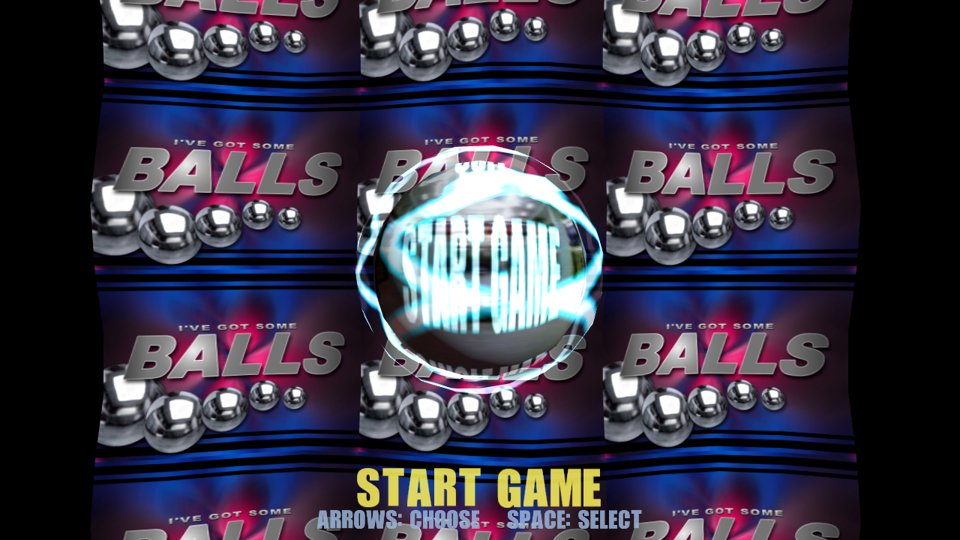
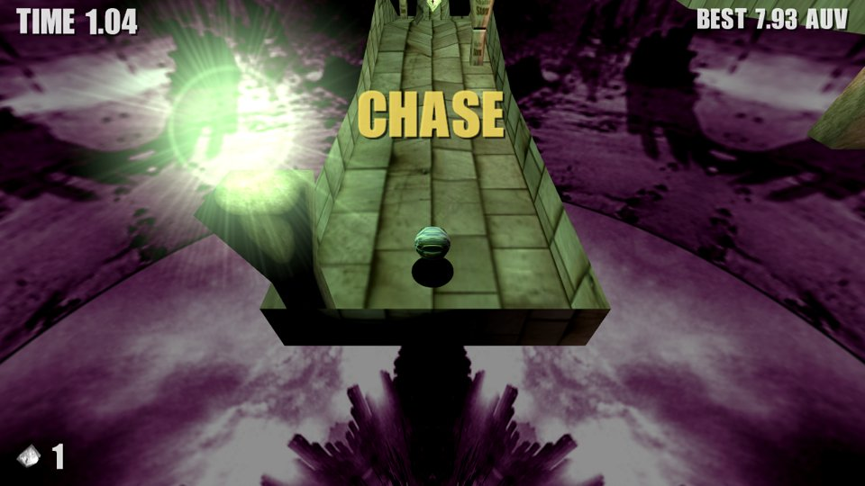
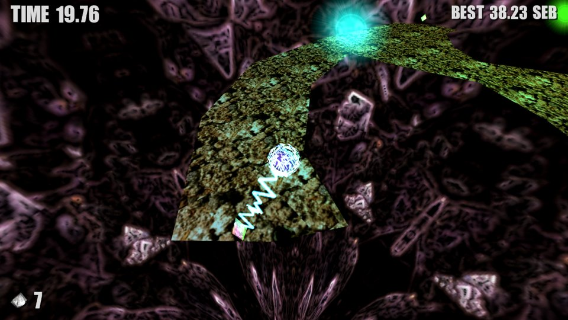

# I've Got Some Balls — Godot port

A Godot 4 port of **"I've got some BALLS" v1.02**, Sebastian Aaltonen's 1999
freeware 3D ball-rolling game. Roll a small ball through 12 levels, collect
every diamond as fast as you can, and use coloured gates to become a red
(fast), yellow (jumping), blue (zaps diamonds from a distance) or green
(brakes and hovers) ball.

The original came only as a Direct3D 6 executable, so the game logic was
reverse engineered from the binary and checked against the best-time replays
shipped with it (see [docs/REVERSE_ENGINEERING.md](docs/REVERSE_ENGINEERING.md)).
All 15 original levels, textures, sounds and music are included and loaded
from the original file formats, so custom levels made with the original
`MAKEMAP.EXE` still work.





## Running

1. Install [Godot 4.7](https://godotengine.org/download) (standard build, no
   .NET needed).
2. Open `project.godot` in the editor and press **Play**, or run
   `godot --path .` from this folder.

### Controls

| Key | Action |
|---|---|
| Arrow keys / D-pad | Accelerate the ball relative to the camera |
| Space / A | Ball ability (jump, brake…) and menu select |
| R / Back | Restart level |
| C / Y | Toggle camera mode |
| Esc / Start | In-game menu (pauses), back in menus |
| Alt+Enter / F11 | Fullscreen |
| F2 | Toggle classic per-vertex / modern lighting |
| F12 | Quit immediately |

Keys can be remapped in **SETUP → CHANGE CONTROLS**. As the original manual
says, the arrow keys do not steer; each one adds speed in its direction.

### Menus

* **START GAME** plays the 12 levels in the original order.
* **SINGLE MAP** plays any level, including custom ones.
* **TOP SCORES** lists best times. Select one to watch its replay; the
  original 1999 world records are included.
* **SETUP** has volume, fullscreen, antialiasing, the original SPECULAR option,
  classic or modern lighting, light glows, CLASSIC STEERING and an FPS counter.
  CLASSIC STEERING reproduces the original's quirk where Right alone
  accelerates at 70%.

Best times, initials and best-time replays are saved in Godot's user data
folder (`user://records.cfg`, `user://replays/`). Replays use the original
`.rep` format.

## Custom levels

Put `.3do` files compiled with the original `MAKEMAP.EXE` (see
`docs/original/makemape.txt`) into the `maps` folder under the game's user
data directory, which Godot calls `user://maps/`. On Linux that is
`~/.local/share/godot/app_userdata/I've Got Some Balls/maps/`. Their BMP or PNG
textures can go in the same folder.

## Project layout

```
assets/        converted original assets (PNG textures, WAV, OGG music,
               original .3do/.rep/.rec data, bitmap font)
src/format/    .3DO / replay readers, coordinate conversion
src/sim/       deterministic physics (BallWorld, SimObject, RouteTable)
src/world/     rendering: meshes, materials, lights, effects
src/game/      game session (fixed 16 ms tick, replays, records) and HUD
src/ui/        3D main menu, menu lists, bitmap font
src/autoload/  Settings, Records, Sound singletons
tests/         replay verification and end-to-end smoke test
tools/         convert_assets.py: rebuilds assets/ from the original release
```

The simulation (`BallWorld`) has no scene dependencies. It runs at the
original fixed rate and the renderer interpolates between ticks, so motion is
smooth at any frame rate.

## Tests

```sh
godot --headless --import                                   # once
godot --headless --script res://tests/replay_check.gd       # physics vs. 1999 replays
godot --headless res://tests/smoke_test.tscn                # menus, play-through, records, replay
```

Both also run in GitHub Actions (`.github/workflows/tests.yml`).

## Rebuilding the assets

`assets/` was generated from the original release archive with:

```sh
pip install pillow   # ffmpeg with libopenmpt is also required for the music
python3 tools/convert_assets.py path/to/extracted/ivegotsomeballs
```

## Differences from the original

* Rendering uses Godot's lighting. Light ranges are stretched to approximate
  Direct3D 6's constant attenuation, and per-vertex lighting is available.
* Motion is interpolated between simulation ticks. The original rendered the
  last tick directly.
* Original replays play back with the recorded ball positions, so even the
  ones from pre-release builds look exactly as they did.
* Gamepad support, key remapping persisted per action, and widescreen.

## Credits

*I've got some BALLS* © 1999 Sebastian Aaltonen (Shatterstorm), released as
freeware with permission to redistribute. Programming, design, 3D models and
levels: Sebastian Aaltonen. Textures: Sebastian Aaltonen, Jaakko and Jukka
Tapio, Heikki Väisänen. Music and sound effects: Tommi Lahtinen. English
documentation: Ismo Horppu. The original documentation is in `docs/original/`.

This port is an unofficial fan project. All original assets belong to their
authors.
